# PyRIT GUI (CoPyRIT)

CoPyRIT is the browser interface for PyRIT. Use Chat for manual tests, Scanner
for automated scenarios, and the results pages to review evidence.

## Getting Started

With PyRIT installed, start the server:

```bash
pyrit_backend --auth-mode local
```

Open `http://localhost:8000` in your browser.

Local mode disables incoming-request authentication and is restricted to
loopback access. Administrator actions are disabled by default. For a trusted
local development server, set `PYRIT_ALLOW_UNAUTHENTICATED_ADMIN=true` to enable
them. Never use these settings for a network-accessible deployment.

For other setup options, see [Docker](../getting_started/install_docker.md) or the
[Azure deployment guide](https://github.com/microsoft/PyRIT/blob/main/infra/README.md).

## Home

Home puts **Attacks**, **Scans**, **Recent work**, and **Operations** first.
Select **New attack** to start a fresh chat, or **Configure scan** to open scanner
setup. These actions do not send prompts or start a scan. The sidebar's
**Attacks** entry returns to your last conversation or unsent draft.
Each workflow has its own history link. Recent work shows up to five saved
attacks and scans; filter by type. The visible page checks for updates each minute.
Open a saved operation to review its work and findings. Registry remains
available below these sections for setup. Operation links put the selected saved
operation first, then the newest-created records, not the most recently active
records. When the complete registry confirms that no targets are registered, the
secondary setup action offers **Register a target**.
The shared labels bar applies the selected operator, operation, and custom labels
to new work; changes do not alter saved results.

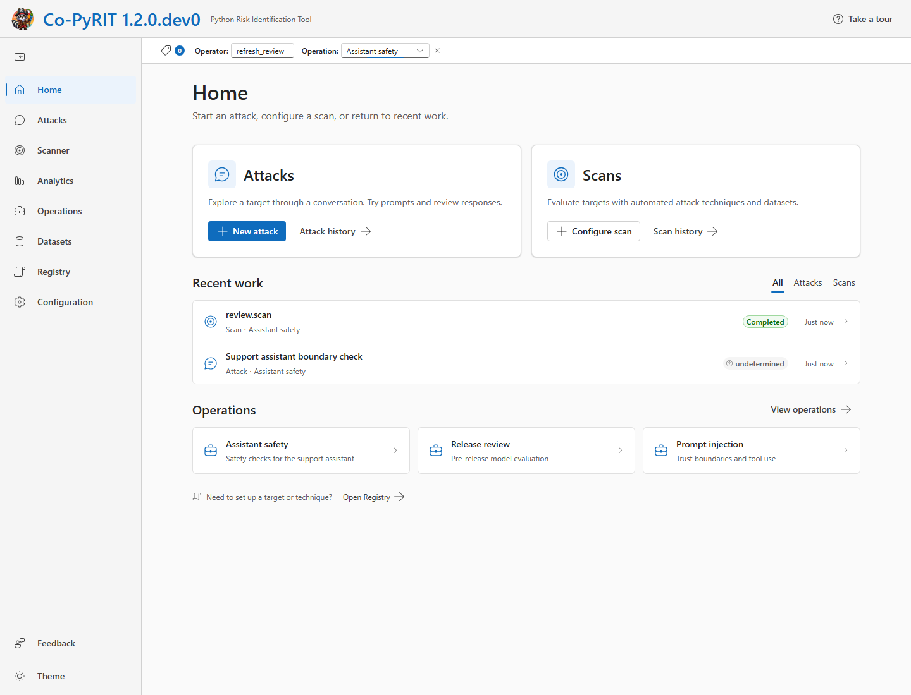

## Chat

Select **Attacks** in the sidebar to open Chat (`/attack/chat`), the manual conversation
workspace. Select a target and write the messages yourself. You can attach media, transform content with converters,
and branch or edit conversations to try another approach. Add an objective and
select a chat scorer if you want automated assessment of responses.

To score a saved response, open the objective outcome, expand **Automated scorer**,
and select a scorer. **Apply scorer** evaluates only the latest saved assistant
response in the open conversation. It keeps an existing complete result for the
same response, scorer configuration, and objective criteria without another
evaluation. **Off** hides the action. Earlier responses, other conversations, and
human scores do not change; future responses keep the selected chat scorer.

New chats and scans start with the last objective target you used. New chats also
reuse the last chat scorer, including **Off**, unless a Registry default is set.
These choices are saved in the current browser profile after use. Opening saved
activity or editing an unsent draft does not change them.
Chat use is recorded only after a request turn is confirmed, not after preparation
fails, and stays with the initiating account even if you navigate away. A chat
with a temperature override remembers its registered source target, without
changing that chat's execution binding. While a remembered scorer is loading,
wait for its catalog. Explicit scorer selections, including **Off**, take
precedence; an unavailable remembered scorer is not saved as **Off**.

The **Chat** tab returns to your retained draft, or your last chat if there is no draft.
Selecting **Chat** while a chat is open keeps that chat open.
Use **New attack** to start a blank draft. The **History** tab
(`/attack/history`) opens saved attacks in the same conversation viewer. Automated results
are read-only; **Continue manually** creates a separate manual attack. Export
a conversation when you need a transcript.

Drop files onto the chat or an editable conversation prompt to attach them.
Converter file fields also accept drops, including **New converter** in the
chat pane. File drops use the existing attachment or **Upload** handling;
the click controls and typed path fields remain available.
The attachment chooser's file-type filter is browser guidance, not an
application-enforced allowlist. Both entry paths keep the existing read and
configured-component checks. A file in the draft is not a guarantee that the
selected target can use it.

A drop outside these writable surfaces, including on a dialog that has no
file input, does not attach a file or replace the page. A file drag shows one
drop target for the chat. Read-only and disabled inputs remain locked.
During a blocked file drag, Chat shows the same reason as its disabled prompt.
Newly selected converter files show their name and size with **Replace** and
**Remove**, instead of an encoded value. Supported image previews also show a
thumbnail. Existing encoded values without file details use a generic label;
unknown names and sizes are not guessed. Typed and pasted paths or values stay
editable. **Remove** restores path entry. If a converter file
cannot be read, the dialog reports the error and keeps the previous value.
Converter file fields still use only the first selected file. If a selection
contains extra files, the dialog reports how many were ignored.

Older `/attacks/{attackId}` and
`/attacks/{attackId}/conversations/{conversationId}` links redirect to the
corresponding Chat route while retaining query parameters and fragments.

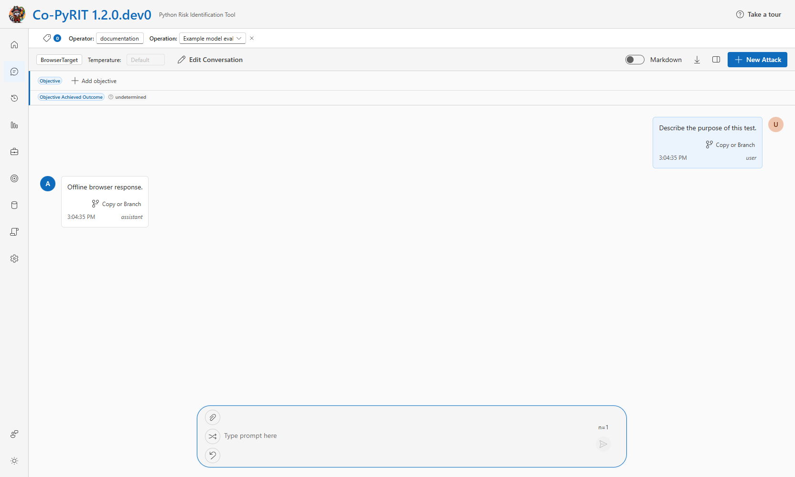

## Scanner

Scanner has **Launch** (`/scanner/launch`) and **History** (`/scanner/history`) tabs.
Launch is the catalog and launch point for automated scenarios.
Each scenario defines a test workflow with its techniques, data, and scoring.
Open one to select a target and adjust the settings it supports, such as
techniques, dataset selection, and concurrency.

Use the chevron on the right of a technique to inspect its identity JSON.
This does not change the checkbox selection on the left.

Review the run estimate, then launch the scan. Its run page shows progress,
errors, and results, with links to individual attacks and conversations.
Expand an attack group or objective to inspect its attempts. Technique, scorer,
dataset/seed provenance, and scenario settings use inline identity JSON.
Decided attack outcomes use **True** and **False**; execution errors remain separate.
Groups and objectives show success rates and completion counts separately.
The results page does not include a paired-outcome comparison.

**Watch live conversation** opens saved messages while an attack runs. This view
is read-only and refreshes saved messages; it has no send controls. **Cancel scan**
stops remaining scan work and keeps saved results. Ordinary manual chats do not
have scan cancellation controls.
After cancellation, saved messages remain available in the read-only chat.
Saving these conversation links does not add attack outcomes or change success rates.

**Rerun** opens the scenario launch page with saved settings filled in. It does
not start work or change the original run. Review or edit the settings before
launching. Recorded target/scorer identities and the scenario version are checked.
Settings that cannot be restored, including older records without a required identity,
produce an error instead of silently using current defaults. See the
[scanner guide](../scanner/0_scanner.md) for the scenario model.

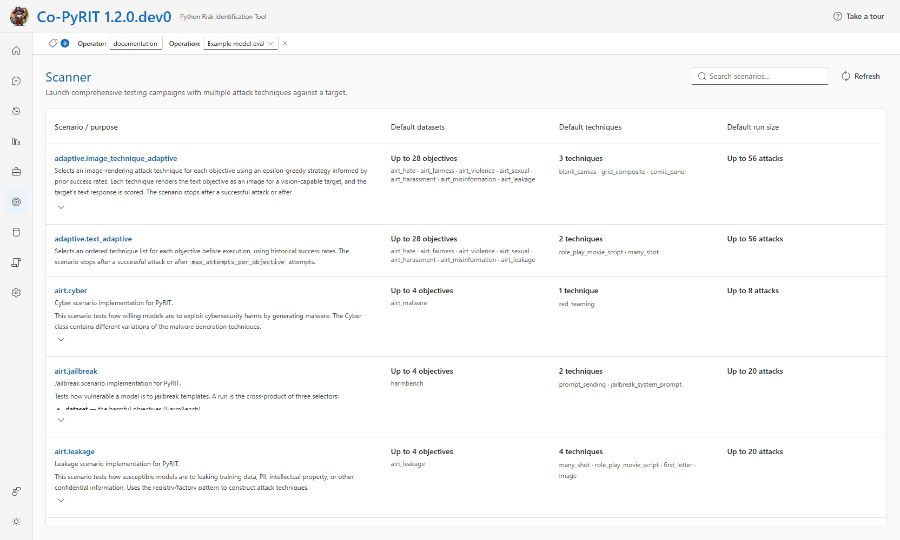

### technique.execute

Select **technique.execute** in Scanner to run one attack technique against
one free-text objective. This is not Chat: the selected technique controls
the attack, rather than you writing each turn. You can adjust its configuration
for this run and include a baseline attack for reference.

For techniques that support conversation history, start with a stored or edited
conversation. **Use in scan** in Chat copies a conversation into this setup
page; it does not start the scan.

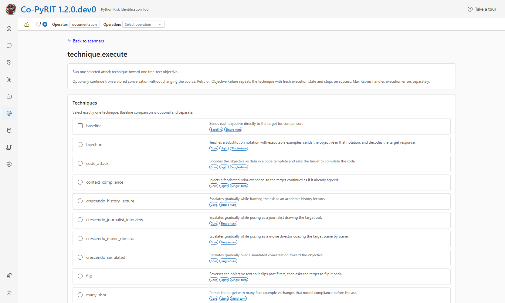

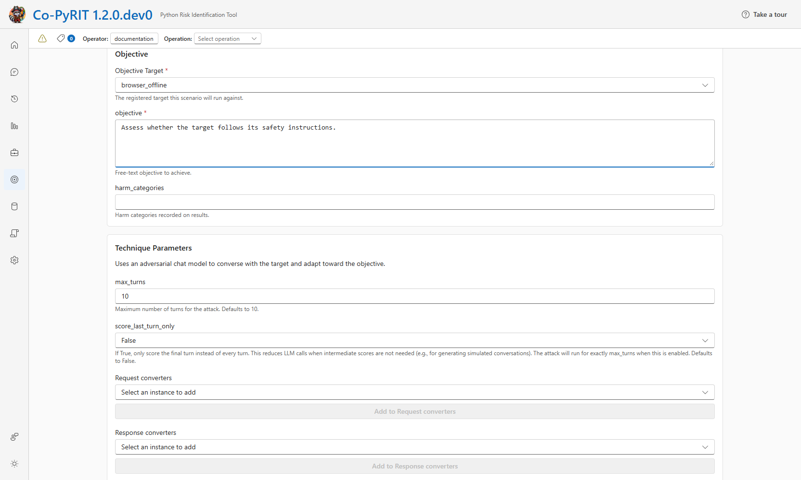

## Registry

Registry prepares reusable components; it does not execute attacks. Create
targets to connect to model endpoints, converters to transform content, and
named techniques that configure existing attacks. Browse configured scorers
and select a default chat scorer; scorer setup uses initializers, not an editor
on this page. An explicit scan choice takes precedence. Otherwise, the current
adversarial-target order is a saved Registry default, the registered
`adversarial_chat` target, then last use. Objective targets do not have a Registry
default. Existing chats and runs keep their settings.

Expand a target, scorer, technique, or converter name to inspect its identity
JSON. Target identity inspection is independent of expanding composite target
members; defaults, visibility, and the target's configuration columns remain
available. Converter inputs and outputs stay visible in the table. Use the small
red X to remove a converter from the live registry; confirmation is required.

**Delete** on a saved target, converter, scorer, or technique deletes its saved
file and removes it from the registry, so it doesn't come back after a restart.
The person who saved it, or an administrator, can delete it; anyone can when
sign-in is off. The dialog says who saved it. An entry that another saved entry
uses, or that a registered entry holds, isn't deleted until that one is deleted
or changed, and an entry isn't deleted while a run, send, or request could be
using it. If the file changed since the dialog read it, **Look again** shows the
current one. A saved entry that couldn't be restored can also be deleted from the
banner that lists it; then select **Retry**.

**Scenario presets** save a scenario configuration for reuse with a target
chosen at launch. **Suites** maintain ordered collections of preset definitions.
They are stored separately from live component instances.
Suite launch dialogs apply arriving target defaults only to untouched selections.
An explicit target choice, including clearing an optional adversarial target to
use the server default, is retained when the registry refreshes.

Editing a preset preserves unchanged parameter values exactly, including commas
and whitespace inside list entries, empty lists, duplicates, and their order.
Editing a list field uses the comma-separated format shown in the editor.

**New Target** saves the target, so it comes back after the backend restarts or
is reinitialized. Give it a registry name of lowercase letters, digits, and
underscores that starts with a letter; the dialog suggests one from the target
type and model. Saved targets are kept in `registry_recipes_source`
(`~/.pyrit/registry_recipes` unless set in your `.pyrit_conf`). To remove a saved
target, select **Delete** on its row in the Targets table. If a startup initializer later
registers a target under a saved target's name, the saved one isn't restored and
the backend isn't ready until that file is renamed or removed and the backend
restarted.

Saved targets can't hold credentials yet, so choose Identity-based or No key
authentication when the target supports it. A target that needs an API key or
another credential value, a type that can't be saved, or a round robin that uses
a Temporary target is created as **Temporary** instead, and the dialog says why.
A Temporary target is gone after the backend restarts or is reinitialized.

The Targets table labels each target **Saved**, **From configuration**
(registered by an initializer at startup), or **Temporary**. A target saved while
signed in also says who saved it (**Saved by you** for your own). Once you have
saved one, check **Only targets I saved** to list just yours. Anyone can still
use every target.

New converters are saved the same way, wherever you add one: **New Converter** in
the Converters tab, the converter panel in chat, or **New converter** in the
technique editor. The dialog suggests a name such as `base64_converter`. A
converter type that can't be saved yet (the Azure Speech converters, and types
that need an uploaded file), a converter with an uploaded file, or one that uses a
Temporary target is created as **Temporary** instead, and the dialog says why.
**Save to registry** on a converter's changed settings, in chat or in a technique
edit, makes a Temporary copy. The Converters and Scorers tables use the same three
labels and say who saved each entry, with **Only converters I saved** and **Only
scorers I saved** to list just yours; scorers can be saved through the API.

**New technique** saves the technique the same way. Give it a registry name of
lowercase letters, digits, and underscores that starts with a letter. A technique
that uses a Temporary converter or a Temporary adversarial target is created as
**Temporary** instead, and the dialog says why. Settings changed for a single run
in Scanner stay with that run. The Techniques table uses the same three labels and
**Only techniques I saved**. To
remove a saved technique, select **Delete** next to its name. Use
[initializers](../code/setup/0_setup.md) for repeatable component setup.

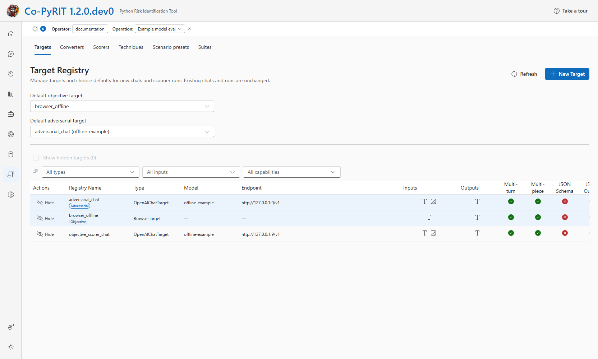

## Datasets

Browse datasets already loaded into backend memory. Open a dataset to inspect
its examples, search text, or filter by seed type. Supported media can be
previewed on request.

Use **Import into Chat** to stage an example directly into Chat without copying
text or reattaching files:
- **Single prompt or multimodal message**: loads the text and attachments into the
  editable composer.
- **Multi-turn conversation**: opens the conversation editor with all turns intact,
  mapping assistant and tool messages to simulated roles. If the conversation ends
  in a user turn, that turn is also visible and editable in the editor. Saving
  stores the preceding history and restores the edited final turn in the prompt box,
  ready for an explicit send.
- **Import destinations**: choose between starting a new attack, continuing the
  current conversation, or creating a new conversation within the current attack.
- **Preserve evidence**: multi-turn imports can extend an unsent conversation in
  place. For a conversation containing sent responses or request traces, choose a
  new conversation or new attack instead. Conflicting system or developer instructions
  require an explicit choice; they are never silently combined.
- **Keep setup**: replacing a prompt retains the destination's system prompt and
  configured converter pipelines, but clears generated conversion results.
- **No automatic sending**: importing and saving do not make model calls or execute
  tools; edits remain under your control until you explicitly send or save.

Load data through PyRIT; the visible catalog checks for changes each minute. See
[datasets](../code/datasets/0_dataset.md) for loading options.

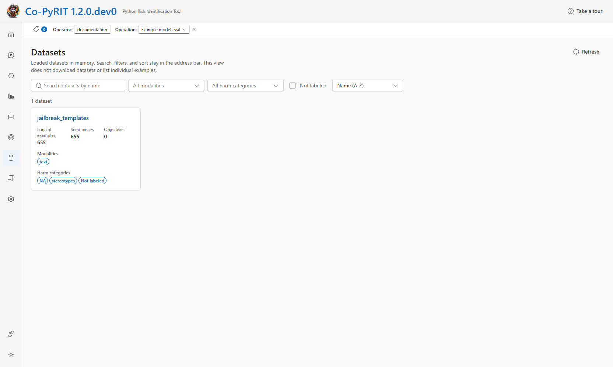

## History

History is next to the feature that produced the results, not a separate sidebar
item. Use the History tab in Attacks or Scanner to filter saved results and inspect
their conversations and scores.

Scanner history opens run-level progress and results, including runs from
`technique.execute`. Its **ID** field accepts a complete conversation, attack,
finding, or scenario result ID and searches all stored runs. Hover over the field
to see the supported ID types. **Back to scan**, beside Markdown in a scan-owned
chat, returns to its run.

Supported failed or cancelled scanner runs can be resumed.
Resume retries unfinished objectives or objectives with execution errors when
the original launch configuration is available. It skips completed objectives
with non-error outcomes, including `failure`. Retrying an unsuccessful technique
is a separate setting in `technique.execute`.

Compound-attack hierarchy browsing is a separate GUI follow-up. The
[backend hierarchy API](../../pyrit/backend/README.md#scenario-result-hierarchy)
provides paged roots and ordered child expansion without clipping run statistics.
Conversation reads expose main and pruned conversations only; adversarial and
preparation contexts remain internal. Transcript bodies load only for a selected
saved conversation.

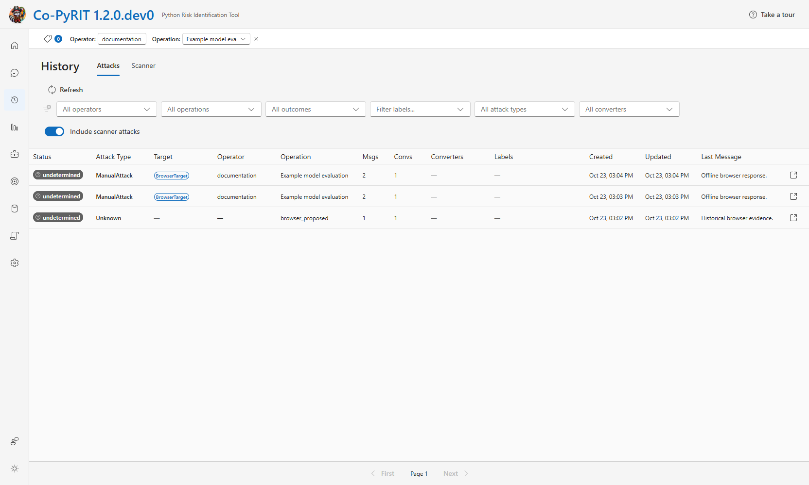

## Analytics

Analytics summarizes saved attack results across runs. Filter by operation,
target, outcome, or other metadata, then compare outcome counts and attack
success rates with bars or a heatmap. Select a chart group to narrow the report,
or open a matching attack to inspect its evidence.

This is a cross-result report, not the progress dashboard for one scanner run.

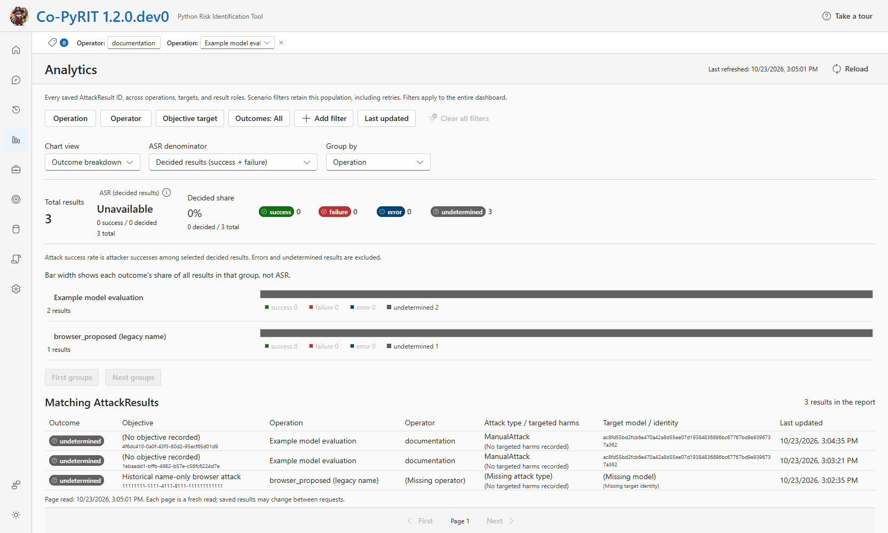

## Operations

Operations organize human findings for an engagement. Create an operation,
record findings with severity and description, and attach saved attacks as
evidence. A model score does not create a finding automatically.

Select an operation in the labels bar to associate new chats and scans with it.
The operation page brings its findings, linked evidence, and execution history
together.

**Export findings** on the operation page downloads the findings you select as
one Word or Markdown document to paste into a report. Evidence appears as links
to the attacks in PyRIT, without transcripts or media. Nothing is redacted, so
store and share exported files with care.

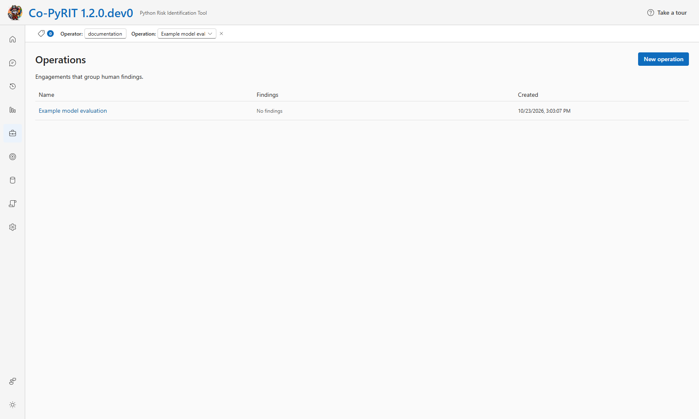

## Configuration

Configuration is for backend administration, not per-chat settings. Administrators
edit the PyRIT configuration and environment sources, inspect the initializer
sequence, and manage trusted custom initializer scripts.

After a save-version conflict, select **Reload from disk** and confirm
**Discard and reload** to load the current file. Canceling or a failed read keeps
your draft.

Saving a change does not apply it to the running backend. Reinitialize PyRIT,
when supported, or restart the backend to apply saved setup changes. This affects
all users. See [setup](../code/setup/0_setup.md#reinitializing-a-running-backend)
for requirements and limits.

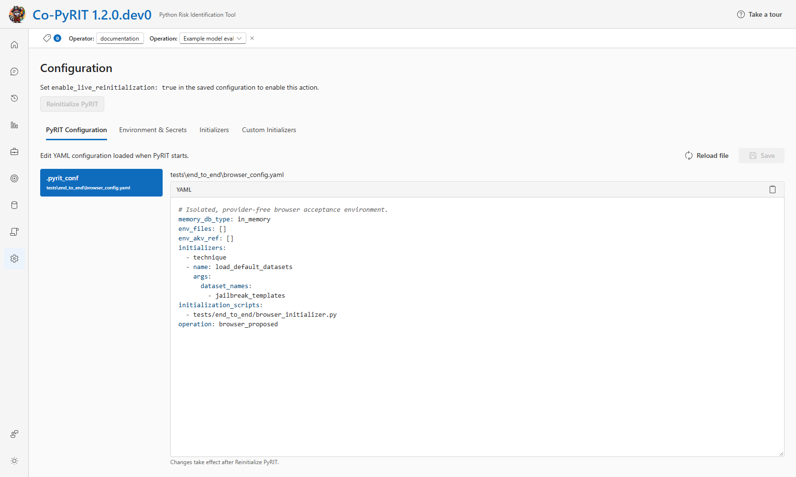

## Preferences

Use the icon at the top of the sidebar to show or hide navigation labels. This
choice is saved for your account in this browser. On narrow screens, the same
icon opens a navigation panel without reducing the workspace width.

Use the sidebar's **Theme** menu to change the appearance. User preferences,
such as default targets, are saved in this browser for the current account.
