# PyRIT GUI (CoPyRIT)

CoPyRIT is the browser interface for PyRIT. Use Chat for manual tests, Scanner
for automated scenarios, and the results pages to review evidence.

## Getting Started

With PyRIT installed, start the server:

```bash
pyrit_backend --auth-mode local
```

Open `http://localhost:8000` in your browser.

Local mode disables incoming-request authentication and is restricted to
loopback access. Administrator actions are disabled by default. For a trusted
local development server, set `PYRIT_ALLOW_UNAUTHENTICATED_ADMIN=true` to enable
them. Never use these settings for a network-accessible deployment.

For other setup options, see [Docker](../getting_started/install_docker.md) or the
[Azure deployment guide](https://github.com/microsoft/PyRIT/blob/main/infra/README.md).

## Home

Home shows your default objective target and recent attacks grouped by operation.
Open an attack to return to its conversation, or go to Registry to configure a
target. The shared labels bar sets the operator, operation, and custom labels
for new work; it does not change saved results.

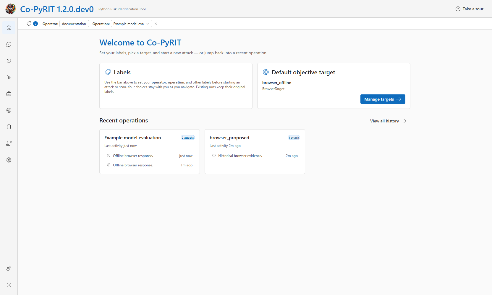

## Chat

Chat (`/chat`) is the manual conversation workspace. Select a target and write
the messages yourself. You can attach media, transform content with converters,
and branch or edit conversations to try another approach. Add an objective and
select a chat scorer if you want automated assessment of responses.

The same conversation viewer opens saved attacks from History. Automated results
are read-only; **Continue manually** creates a separate manual attack. Export
a conversation when you need a transcript.

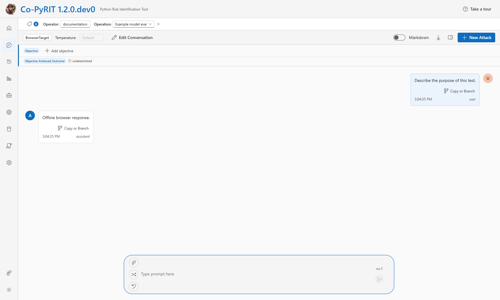

## Scanner

Scanner (`/scanner`) is the catalog and launch point for automated scenarios.
Each scenario defines a test workflow with its techniques, data, and scoring.
Open one to select a target and adjust the settings it supports, such as
techniques, dataset selection, and concurrency.

Review the run estimate, then launch the scan. Its run page shows progress,
errors, and results, with links to individual attacks. See the
[scanner guide](../scanner/0_scanner.md) for the scenario model.

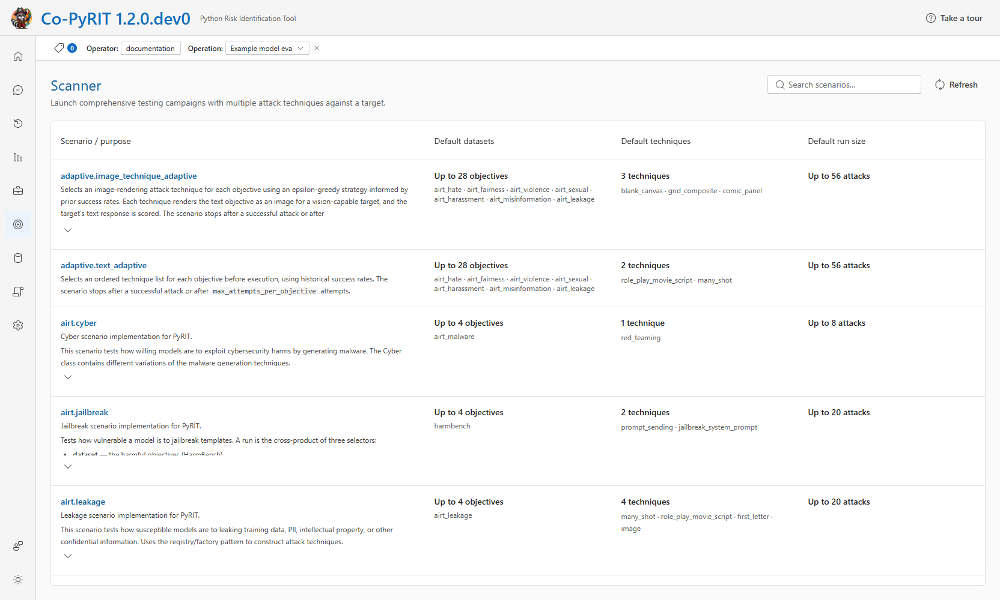

### technique.execute

Select **technique.execute** in Scanner to run one attack technique against
one free-text objective. This is not Chat: the selected technique controls
the attack, rather than you writing each turn. You can adjust its configuration
for this run and add a baseline comparison.

For techniques that support conversation history, start with a stored or edited
conversation. **Use in scan** in Chat copies a conversation into this setup
page; it does not start the scan.

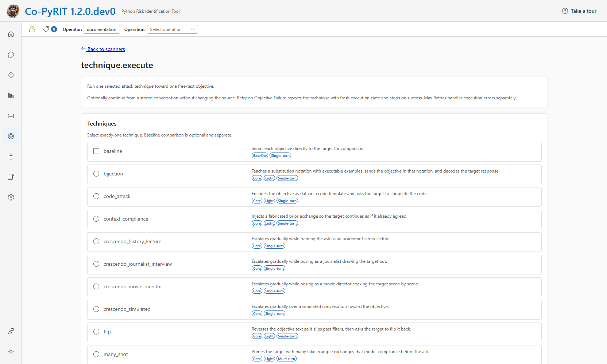

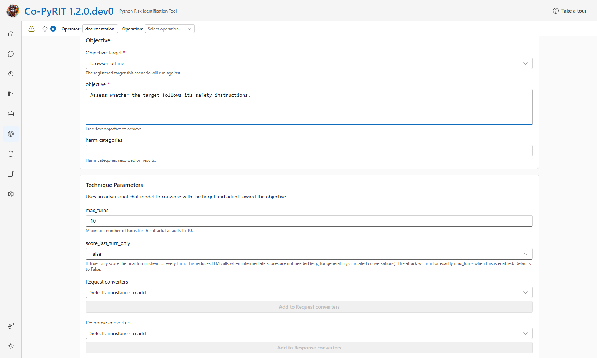

## Registry

Registry prepares reusable components; it does not execute attacks. Create
targets to connect to model endpoints, converters to transform content, and
named techniques that configure existing attacks. Browse configured scorers
and select a default chat scorer; scorer setup uses initializers, not an editor
on this page. Target defaults apply to new chats and scans.

**Scenario presets** save a scenario configuration for reuse with a target
chosen at launch. **Suites** maintain ordered collections of preset definitions.
They are stored separately from live component instances.

Targets, converters, and techniques added only to the live registry must be
recreated after a backend restart or reinitialization. Use
[initializers](../code/setup/0_setup.md) for repeatable component setup.

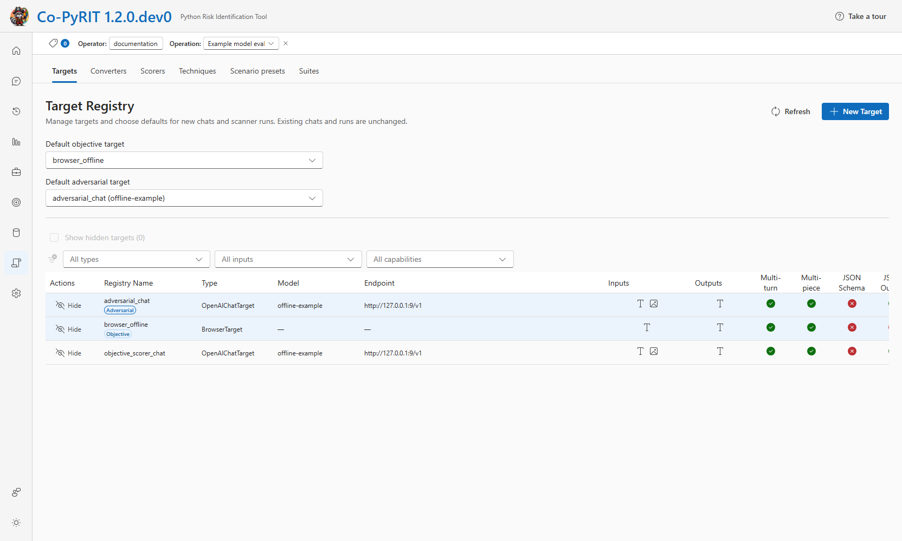

## Datasets

Browse datasets already loaded into backend memory. Open a dataset to inspect
its examples, search text, or filter by seed type. Supported media can be
previewed on request.

Load data through PyRIT before refreshing this catalog. See
[datasets](../code/datasets/0_dataset.md) for loading options.

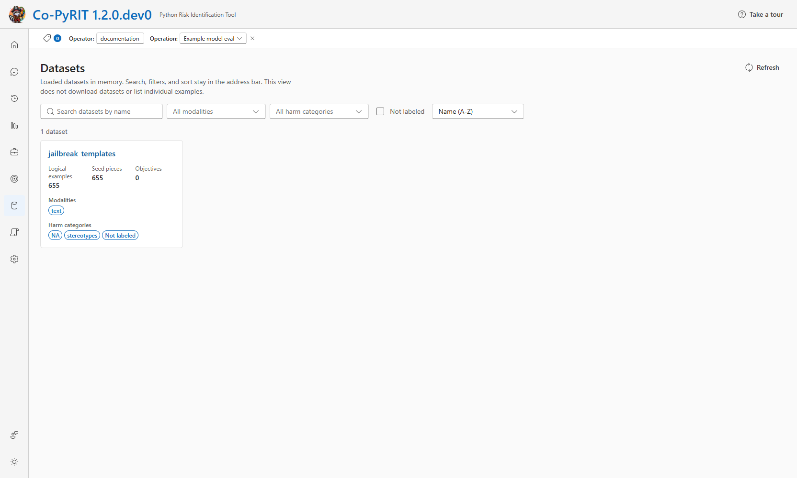

## History

Find saved attacks and scanner runs. Filter the list, open results, and inspect
the conversations and scores. Supported failed scanner runs can be resumed.

The **Attacks** tab opens individual conversations. The **Scanner** tab opens
run-level progress and results, including runs from `technique.execute`.
Resume retries unfinished objectives or objectives with execution errors when
the original launch configuration is available. It skips completed objectives
with non-error outcomes, including `failure`. Retrying an unsuccessful technique
is a separate setting in `technique.execute`.

Compound-attack hierarchy browsing is a separate GUI follow-up. The
[backend hierarchy API](../../pyrit/backend/README.md#scenario-result-hierarchy)
provides paged roots and ordered child expansion without clipping run statistics.
Conversation reads expose main and pruned conversations only; adversarial and
preparation contexts remain internal. Transcript bodies load only for a selected
saved conversation.

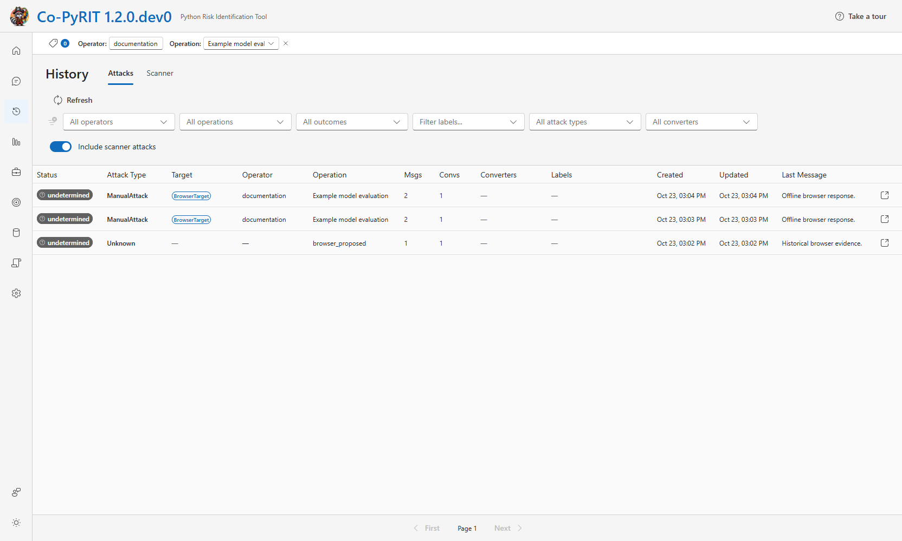

## Analytics

Analytics summarizes saved attack results across runs. Filter by operation,
target, outcome, or other metadata, then compare outcome counts and attack
success rates with bars or a heatmap. Select a chart group to narrow the report,
or open a matching attack to inspect its evidence.

This is a cross-result report, not the progress dashboard for one scanner run.

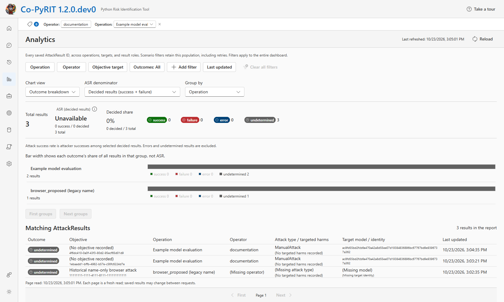

## Operations

Operations organize human findings for an engagement. Create an operation,
record findings with severity and description, and attach saved attacks as
evidence. A model score does not create a finding automatically.

Select an operation in the labels bar to associate new chats and scans with it.
The operation page brings its findings, linked evidence, and execution history
together.

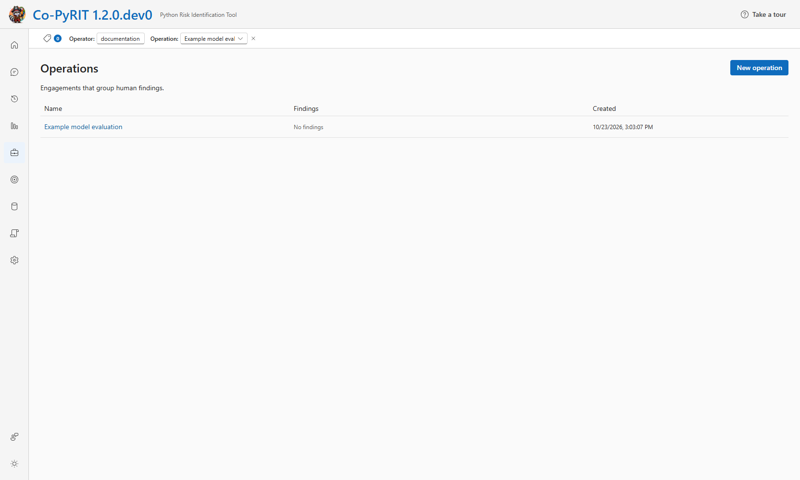

## Configuration

Configuration is for backend administration, not per-chat settings. Administrators
edit the PyRIT configuration and environment sources, inspect the initializer
sequence, and manage trusted custom initializer scripts.

Saving a change does not apply it to the running backend. Reinitialize PyRIT,
when supported, or restart the backend to apply saved setup changes. This affects
all users. See [setup](../code/setup/0_setup.md#reinitializing-a-running-backend)
for requirements and limits.

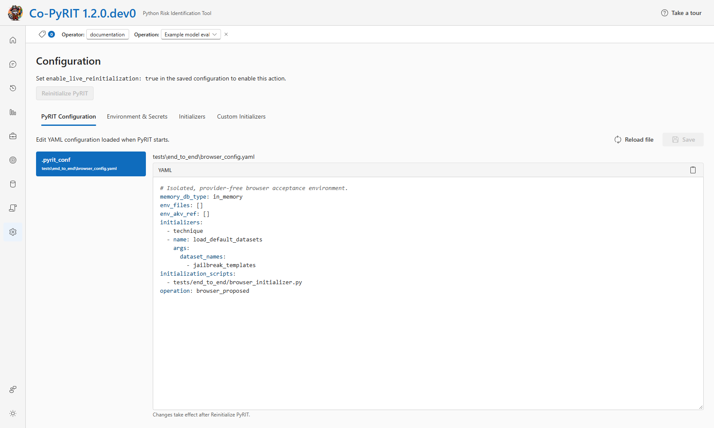

## Preferences

Use the sidebar's **Theme** menu to change the appearance. User preferences,
such as default targets, are saved in this browser for the current account.
